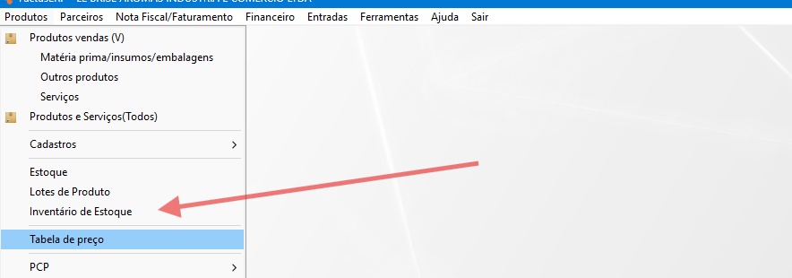
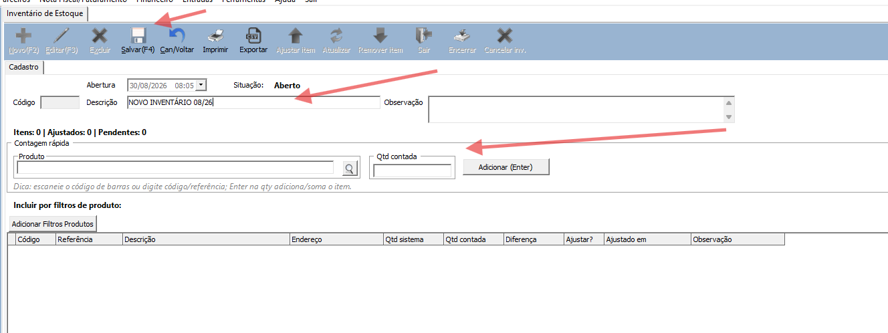
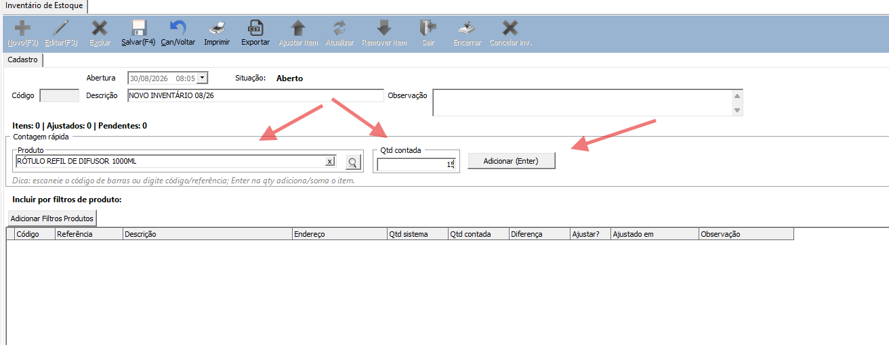
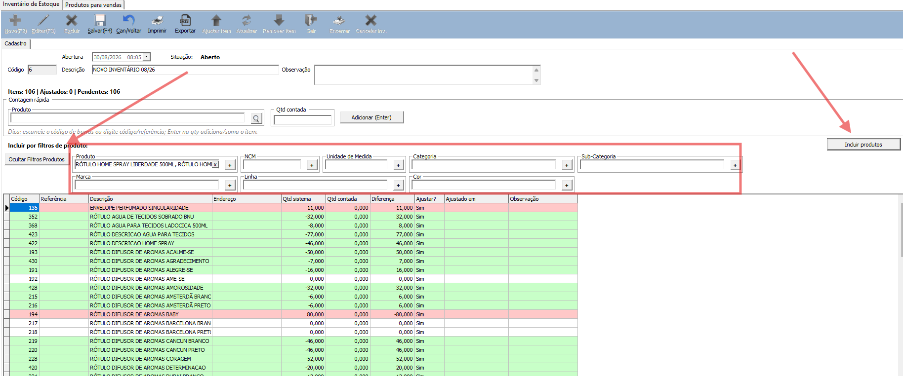
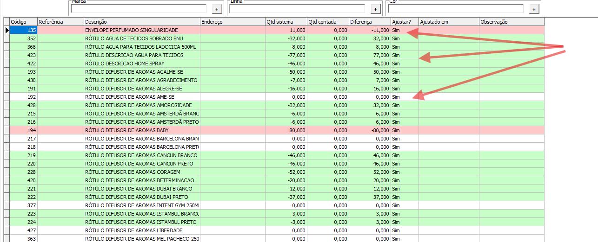
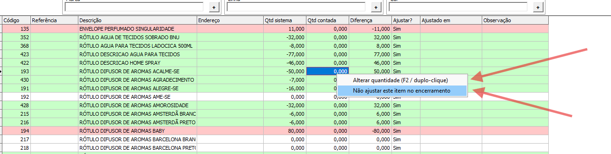
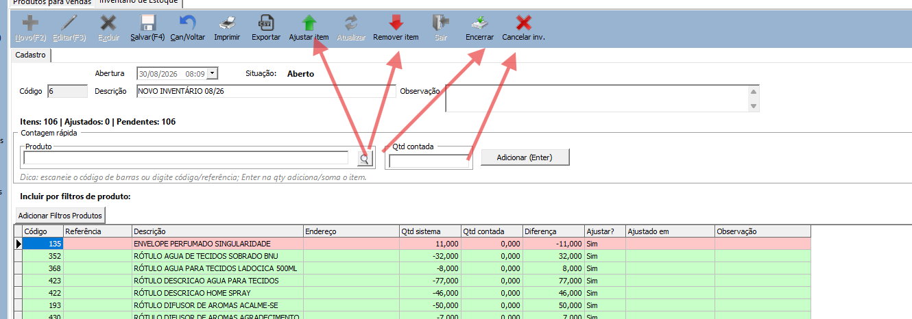

# Inventário de Estoque

O Inventário de Estoque serve para conferir fisicamente o que você tem no depósito e comparar com o saldo que o sistema calcula. Você pode inventariar tudo, só uma categoria de produtos, uma linha específica, ou produtos avulsos escolhidos um a um.

Ao final da contagem, você decide o que fazer com cada diferença encontrada: ajustar o estoque automaticamente ou deixar para investigar depois.

---

## Como acessar

**Estoque → Inventário de Estoque**

---

## Permissões

Dois perfis controlam o que cada usuário pode fazer, configurados no cadastro de usuários, agrupador **Estoque**:

| Permissão | Libera |
|-----------|--------|
| **Administrar Inventário de Estoque** | Criar, encerrar e cancelar inventários; editar filial/descrição/observação |
| **Lançar contagens em Inventário de Estoque** | Adicionar, remover e corrigir itens contados |

!!! tip "Padrão recomendado"
    Dê a permissão de **Administrar** a um supervisor (quem abre e fecha o inventário) e a permissão de **Lançar contagens** aos operadores que fazem a contagem física. Um usuário pode ter as duas.

---

## Fluxo de uso

### 1. Criar um novo inventário

Clique em **Novo (F2)**, escolha a **Filial** e digite uma **Descrição** (ex.: "Inventário depósito principal — agosto/2026"). Salve.

A data de abertura é preenchida automaticamente pelo sistema.

### 2. Contar os itens

Existem duas formas de adicionar produtos à contagem — você pode combinar as duas no mesmo inventário.

#### Contagem rápida (bipagem)

Com o inventário aberto, posicione o cursor no campo de produto e escaneie o código de barras (ou digite a referência/código), informe a **quantidade contada** e pressione **Enter**. O item entra na lista e o foco volta automaticamente para o campo de produto, pronto para o próximo scan.

!!! info "Produto já contado"
    Se você escanear um produto que já está na lista, o sistema avisa e posiciona o cursor na linha existente — a quantidade **não** é somada automaticamente. Para corrigir, use a edição manual (item 4 abaixo).

#### Incluir em massa por filtros

Clique em **Adicionar Filtros Produtos** para expandir o painel de filtros. Escolha uma ou mais combinações — grupo, marca, subgrupo, NCM, entre outras — e clique em **Incluir produtos**.

Todos os produtos que casam com o filtro entram na lista com quantidade contada **zerada**: você só precisa registrar o que realmente encontrar.

### 3. Acompanhar a contagem no grid

O grid mostra: Código, Referência, Descrição, Endereço (depósito, prateleira, coluna, altura), Quantidade do sistema, Quantidade contada, Diferença, se o item será ajustado, data do ajuste e observação.

As linhas são coloridas para facilitar a conferência visual:

| Cor da linha | Situação |
|--------------|----------|
| Vermelho claro | Contagem **menor** que o sistema — falta produto |
| Verde claro | Contagem **maior** que o sistema — sobra produto |
| Sem cor | Contagem igual ao sistema |

### 4. Corrigir a quantidade contada

Dê **duplo-clique** na linha do produto, ou clique com o botão direito e escolha **Alterar quantidade**. Informe o novo valor e confirme.

O valor digitado **substitui** a quantidade contada anterior — não soma. Informar **zero** é válido e significa "não encontrei este produto na contagem".

!!! warning "Atenção com quantidade zero"
    Se um item ficar com contagem zero e for ajustado no encerramento, o sistema entende que o produto sumiu do estoque e gera uma saída da quantidade total. Se você esqueceu de contar um item (e não que ele realmente sumiu), use **Não ajustar este item** (próximo passo) antes de encerrar.

### 5. Excluir um item do ajuste automático

Se você quer manter um produto na lista mas não quer que ele gere movimentação de estoque no encerramento — por exemplo, para investigar a diferença antes —, clique com o botão direito na linha e escolha **Não ajustar este item no encerramento**.

O item continua visível e rastreável, só não gera lançamento quando o inventário for encerrado. Para reverter, use a mesma opção (o texto do menu muda para **Marcar para ajustar no encerramento**).

---

## Bloqueio de produto em inventários abertos

Um mesmo produto não pode estar em dois inventários **abertos ao mesmo tempo na mesma filial**. Se você tentar contar um produto que já está em outro inventário aberto, o sistema bloqueia e avisa em qual inventário ele está.

Para liberar o produto, encerre ou cancele o outro inventário, ou remova o produto de lá.

---

## Encerrar o inventário

Com a permissão de **Administrar**, clique em **Encerrar**. O sistema confirma a ação e, para cada item pendente:

- Se a quantidade contada é **diferente** da quantidade do sistema e o item está marcado para ajustar, gera uma movimentação de estoque (entrada ou saída) com a observação "Ajuste inventário #N" — visível depois em **Movimentação de Estoque**.
- Se a quantidade contada é **igual** à do sistema, não gera nenhuma movimentação.
- Se o item está marcado como **não ajustar**, o sistema só registra que ele foi verificado, sem mexer no estoque.

Depois de encerrado, o inventário fica em modo **somente leitura** — nada mais pode ser alterado nele.

!!! warning "O estoque não fica congelado durante a contagem"
    Vendas, compras e outras movimentações continuam acontecendo normalmente enquanto o inventário está aberto. O "saldo do sistema" usado no encerramento reflete o estoque **no momento em que você encerra**, não no momento em que abriu o inventário. Em contagens longas, revise itens críticos antes de encerrar.

---

## Cancelar o inventário

Com a permissão de **Administrar**, clique em **Cancelar inv.** e confirme. O inventário é marcado como cancelado e fica em modo somente leitura.

!!! warning "Cancelar não desfaz ajustes já aplicados"
    Se você já encerrou itens individualmente (ver ajuste avulso abaixo) antes de cancelar o inventário como um todo, as movimentações de estoque geradas por esses itens **não são revertidas**. Cancelar só impede que o restante dos itens pendentes seja processado.

---

## Ajustar um item antes de encerrar tudo

Se quiser aplicar o ajuste de um único produto sem encerrar o inventário inteiro — por exemplo, numa contagem parcial que ainda está em andamento —, selecione o item e clique em **Ajustar item** na toolbar (também restrita à permissão de **Administrar**). O item recebe o mesmo tratamento que teria no encerramento geral, mas isoladamente.

---

## Situação do inventário

| Situação | O que significa |
|----------|------------------|
| **Aberto** | Pode contar, corrigir quantidades e ajustar itens |
| **Encerrado** | Ajustes já foram aplicados; tela em somente leitura |
| **Cancelado** | Inventário abortado; tela em somente leitura |

---

## Imprimir e exportar

Use o botão **Imprimir** para gerar um relatório com os itens do inventário — título, filial, situação, contadores e todas as colunas do grid. Use **Exportar** para gerar um arquivo CSV com os mesmos dados.

---

## Limitações da versão atual

- **Grade de cor/tamanho** (produtos de confecção) não é considerada — a contagem é feita por produto, sem abrir a grade de variações.
- **Lote e validade** não são tratados por item, mesmo para produtos que controlam lote no cadastro.
- **Saldo do sistema é global**, não segmentado por filial — o inventário é aberto para uma filial, mas o saldo comparado é o total do produto no sistema.

---

<!--
??? note "Referência técnica"

    Fonte: fontes/uInventarioEstoque.pas / uInventarioEstoque.lfm
    Menu: Estoque → Inventário de Estoque (miInventarioEstoqueClick em uPrincipal.pas)
    Tabelas: INVENTARIO (INV_*), INVENTARIO_ITENS (INVI_*)
    Status derivado (sem campo INV_STATUS): cancelado > encerrado > aberto, via IS NOT NULL de INV_DATA_CANCELADO / INV_DATA_ENCERRAMENTO
    Permissões (MENUS, MEN_AGRUPADOR='Estoque', módulo msProdutos): 53=Administrar, 54=Lançar contagens
    Ajuste no encerramento gera MOV_MANUAL_PRODUTO (E se contada > sistema, S se contada < sistema), obs 'Ajuste inventário #<INV>'
    INVI_AJUSTAR CHAR(1) default 'S' controla se o item gera movimentação
    Scripts SQL: 649-652 (schema), 653 (permissões 53/54 em MENUS)
-->
